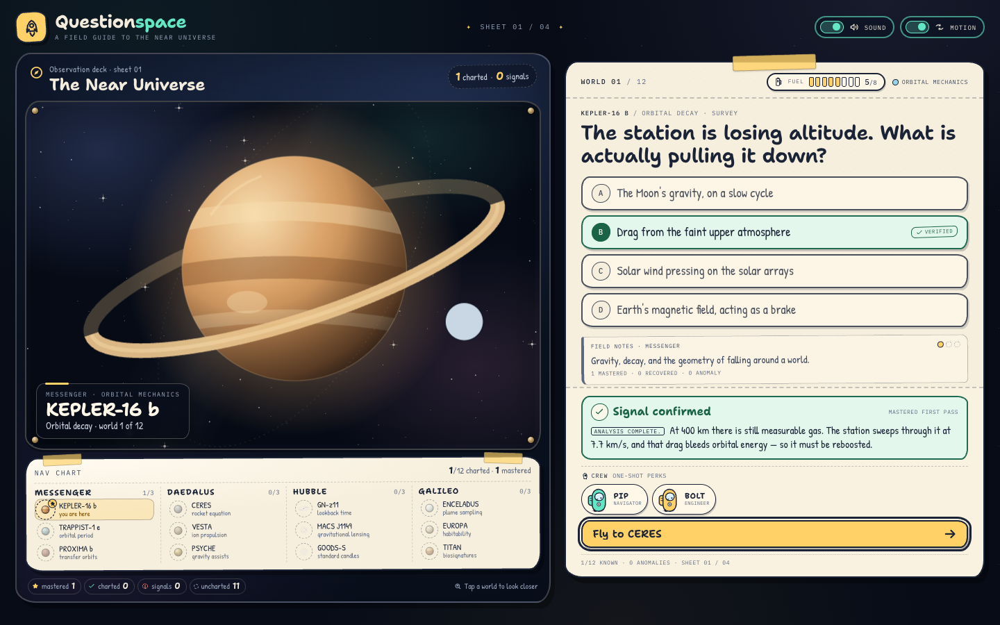
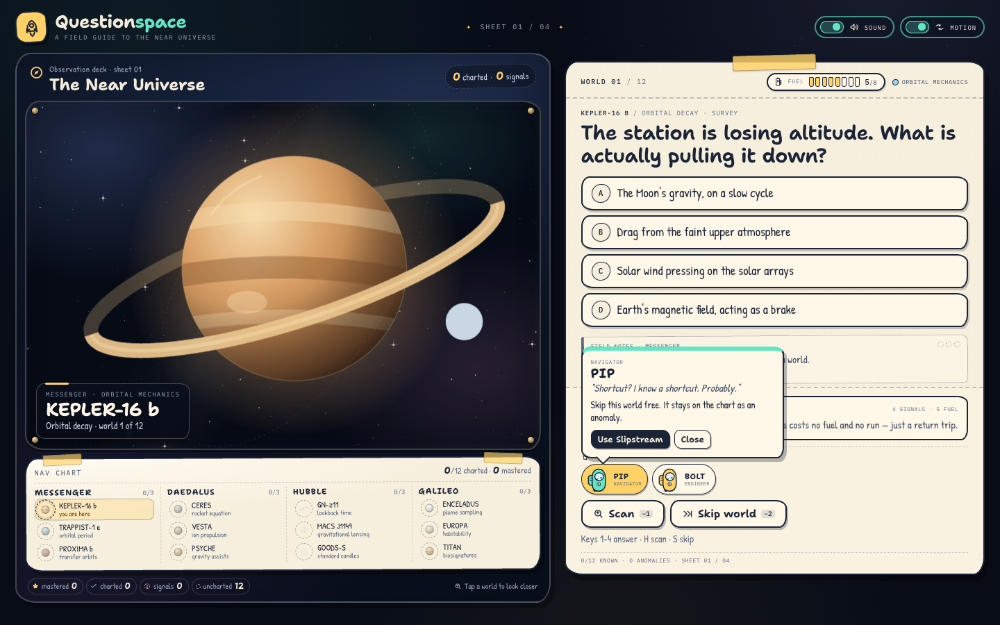
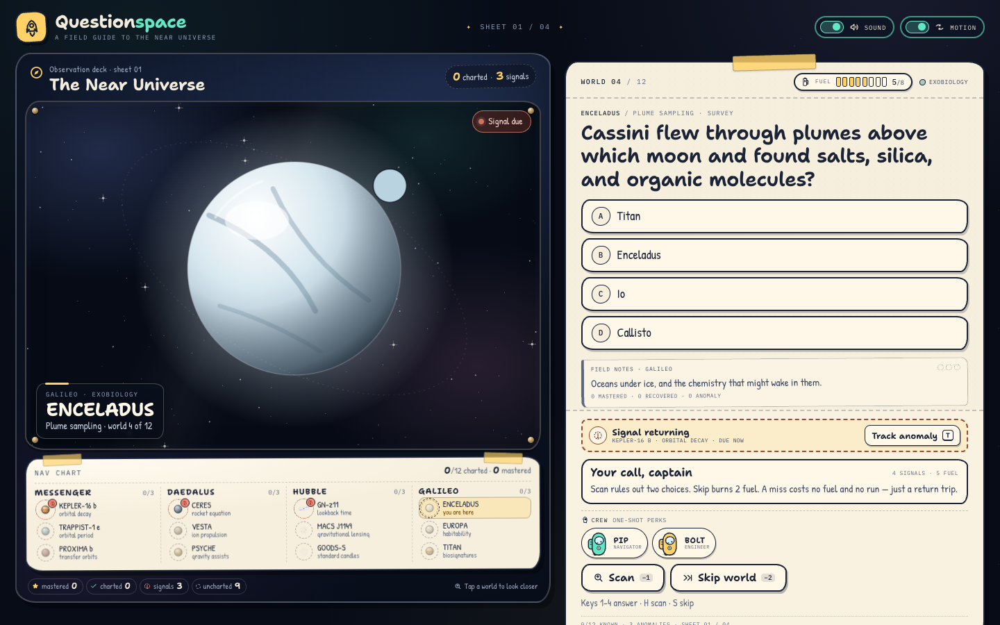
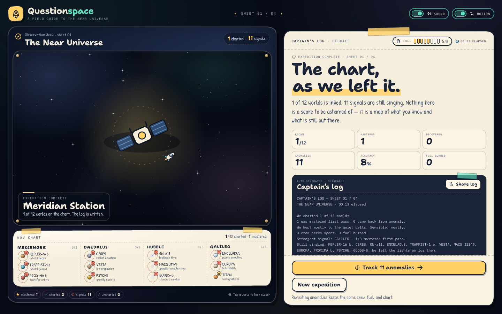
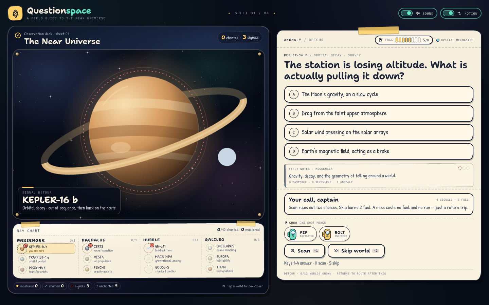
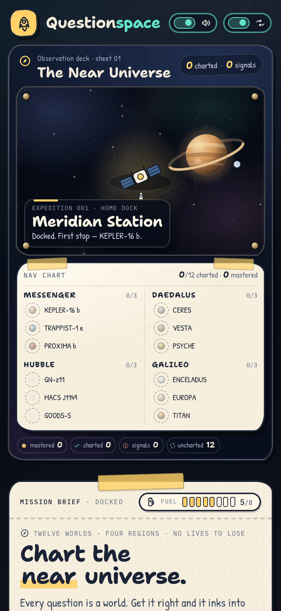
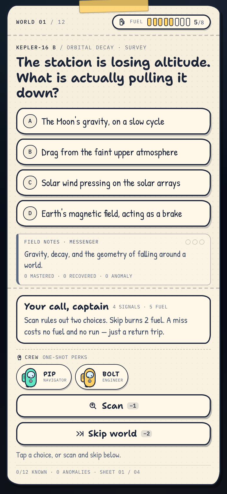

# QuestionSpace

**An illustrated space quiz expedition.** Every question is a planet. Answer it and the
world inks itself into your chart for good; miss it and the signal keeps singing until you
come back for another look.

[**Play it on GitHub Pages →**](https://abhinav-prabhakar.github.io/QuestionSpace/)


---

## The idea

Most quiz apps turn learning into a progress bar. QuestionSpace turns it into a place — and
puts you inside it.

The left panel is the ship's observation window. You look out from the co-pilot's seat:
a hand-drawn brass frame, rivets, a scratched pane of glass, stars and nebulae beyond. The
world ahead fills the window, rings and moons and all. When you fly on, the old world slides
past, the stars streak, and the next planet swells into view. There is no third-person map
to look down at.

Knowledge lives on the **nav chart** taped to the dash below the window. Twelve worlds in
four regions, dim when unknown, inked when charted, starred when mastered, ringed in coral
when a signal is still out there. One glance tells you what you know and which corner of the
sky is still dark.

A wrong answer is **not** a lost life. It is a sample that came back unusual: the world
stays on the chart as a **signal**, and you can fly back to it later.

| Launch | Question |
| --- | --- |
|  |  |

| Correct | Discovery |
| --- | --- |
|  |  |

---

## The observation deck

- **A first-person window.** One world at a time, seen large: a ringed gas giant, an ocean
  world, red and grey rock worlds, a metallic asteroid, two ice moons, a hazy orange moon,
  a spiral galaxy, a lensed cluster, and a deep field. Every surface is inline SVG with
  hand-drawn bands, craters, ice cracks, galaxy arms, rings, and moons.
- **Arrival and departure.** A planet rises into the window as you arrive; the last world
  slides past as you leave, with a short field of warp streaks between. At a route junction
  the window shows both lanes — the calm world on the left, the storm world on the right,
  their routes bending away from the ship.
- **A brass nameplate** in the corner of the pane: region, world name, what the survey is,
  and where you are in the run. Meridian Station gets its own plate, docked and undocked.
- **Hazards read without colour.** A signal world keeps a coral dashed ring around it; a
  due signal lights a coral lamp in the glass. The nav chart repeats the same mark.
- **The nav chart.** Four region columns, three worlds each, with counts per region. Every
  world is a button: its planet glyph, name, and survey tag, with a mint check or amber
  star sticker once it is known. Uncharted worlds keep a dashed halo and a muted glyph.
- **A world card** on tap/click: what the region studies, the world's status, when its
  signal returns, and a shortcut to track it when it is due.

---

## The loop

The question loop is deliberately instant. Animation happens at the *start* and *end* of
a question, never between reading the choices and answering.

1. **Read and answer.** Four choices, instant feedback. Correct answers stay charted.
2. **Spend fuel on optionality.** Fuel is a hint currency, never health — no answer can
   drain it or end the run.
   - **Scan** (−1): a whisper of a hint plus two ruled-out choices.
   - **Skip world** (−2): leave the world as a signal and fly on.
   - **Retry sample** (−1): after a miss, reopen the same question once.
   - Every third world charted salvages one fuel cell (start 5, cap 8).
3. **Lean on the crew.** Four collectible one-shot perks, each with a personality:
   - **Pip**, navigator — free skip.
   - **Bolt**, engineer — +2 fuel.
   - **Dr.Vela**, science — free scan.
   - **Moss**, medic — free retry after a miss.
   You start with Pip and Bolt. Safe and risky lanes at junctions recruit Vela or Moss;
   a duplicate recruit becomes +1 fuel instead.
4. **Pick a lane.** At two junctions the route forks: the **Quiet Belt** is the
   lowest-difficulty remaining world and pays +1 fuel; the **Ion Storm** is the hardest
   and pays +2. Clean passes only — a miss still leaves a signal.
5. **Follow the signal.** A miss or skip schedules an anomaly (`due` after 3 worlds, then
   further out on each return). When it is due, **T** opens it as a detour; you return to
   the same spot on the route afterwards. At the debrief you can revisit every unresolved
   signal in a new pass, keeping the same crew, fuel, and chart.
6. **Debrief.** A captain's log is generated from the run and can be shared or copied.
   The chart, region breakdown, remaining signals, and crew manifest are all there.

| Scan | Crew perk |
| --- | --- |
|  |  |

| Junction | Signal due |
| --- | --- |
|  |  |

| Captain's log | Detour |
| --- | --- |
|  |  |

---

## Controls

| Action | Key |
| --- | --- |
| Answer A–D | `1`–`4` or `A`–`D` |
| Scan | `H` |
| Skip world | `S` |
| Retry sample | `R` |
| Track a due signal | `T` |
| Fly on | `Enter` / `Space` |
| Choose lane | `1` (quiet) / `2` (storm) |
| Close world card | `Esc` |

Touch: tap a world on the nav chart for its card, tap a choice to answer, then the wide
**Fly to…** button. On mobile the observation deck sits above the question sheet and
scrolls with the page.

---

## Accessibility

- **Colour never carries meaning alone.** Feedback pairs a glyph, a word, a border style,
  and a colour. Chart states have distinct silhouettes, stickers, halos, and rings.
- **Full keyboard play**, including the nav chart (`Tab` to a world button, `Enter` to open
  it) and every action button.
- **Visible focus** on paper (dark ring) and sky (amber ring); the prompt itself is focused
  programmatically but does not show a ring on arrival.
- **Reduced motion** honours `prefers-reduced-motion` and an in-app Motion switch. Under
  either, the window jump-cuts between worlds, warp streaks and landing blooms are
  suppressed, and landing advances in 80 ms.
- **Screen readers** get a live status region for answers, hints, signals, and crew, plus
  the full chart described per world.
- **Contrast audit** (`npm run check:contrast`) checks every shipped text pair, including
  alpha-composited stamps and eliminated choices. All pairs pass their WCAG target.
- Skip link to the console, 44 px touch targets, and no hover-only information.

---

## Stack

- **React 19 + TypeScript + Vite** — no animation library, no state library. The run is a
  pure reducer; arrival, departure, and landing are ephemeral UI state.
- **Hand-drawn type**: Shantell Sans (display), Patrick Hand (body), IBM Plex Mono
  (labels), all self-hosted through Fontsource. No font CDN.
- **SVG illustration**: the observation window (worlds, rings, moons, nebulae, station,
  ship) and the nav chart are inline SVG. The starfield is seeded, so it is stable between
  renders.
- **Web Audio** for the ambient hum, radio chatter, and small feedback pings. Audio starts
  from a user gesture and can be switched off at any time.
- **localStorage** persists the expedition (`questionspace.session.v2`), sound, and motion
  preferences. A v1 save is discarded safely.

---

## Run it

```bash
npm install
npm run dev        # http://127.0.0.1:5173
```

```bash
npm run check      # typecheck + 25 tests + contrast audit
npm run build      # production build
npm run preview    # preview the built app
```

The production base path is `/QuestionSpace/` for GitHub Pages; the dev server uses `/`.

---

## Deploy

Pushing to `main` runs `.github/workflows/deploy.yml`:

1. `npm ci`
2. `npm run check`
3. `npm run build`
4. upload `dist/` and deploy with GitHub Pages

Pages is configured with **GitHub Actions** as its source. The live site is
<https://abhinav-prabhakar.github.io/QuestionSpace/>.

---

## Project map

```text
src/
  App.tsx                 phase routing, keyboard map, travel/landing, SR status
  components/
    StarMap.tsx           observation window: worlds, station, junction, nav chart, card
    Console.tsx           question loop, choices, scan/skip/retry, feedback readout
    Briefing.tsx          launch screen, crew intro, rules
    Branch.tsx            quiet/storm lane choice
    Debrief.tsx           stats, captain's log, anomalies, revisit/reset
    CrewDock.tsx          one-shot crew popover
    TopBar.tsx            brand, sound, motion
  data/expedition.ts      worlds, questions, crew, routes
  lib/
    session.ts            reducer, selectors, persistence (schema v2)
    log.ts                shareable captain's log
    audio.ts              Web Audio ambience and SFX
  styles.css              hand-drawn design system, window, chart, responsive, motion
scripts/
  check-contrast.mjs      WCAG audit of the shipped palette
  cdp.mjs                 headless Chrome screenshot harness
docs/                     screenshots used above
```

Questions live in `src/data/expedition.ts`; adding a world means a question object plus a
`LOOKS` entry in `StarMap.tsx` for its planet art.

---

## Screenshots

| Mobile launch | Mobile question |
| --- | --- |
|  |  |

Screenshots are captured at 1440×900 (2× for mobile) with `scripts/cdp.mjs` against a
headless Chrome.
