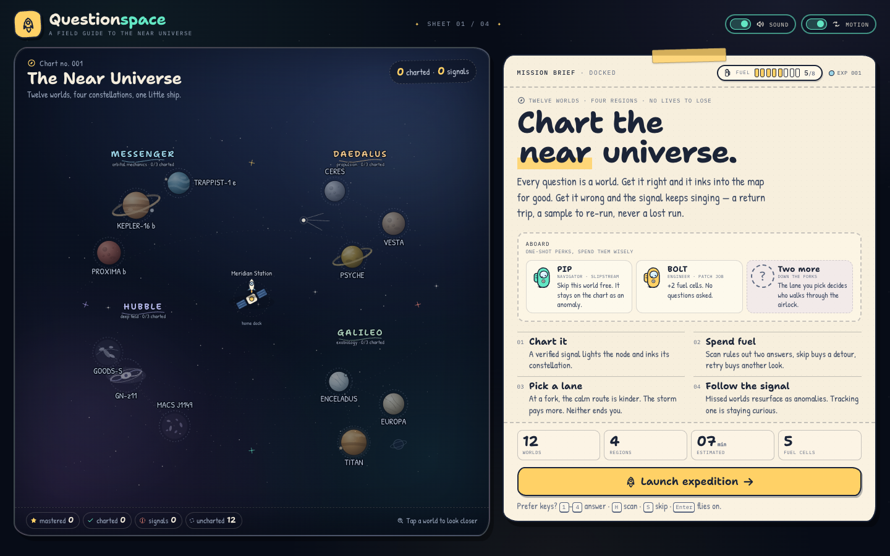
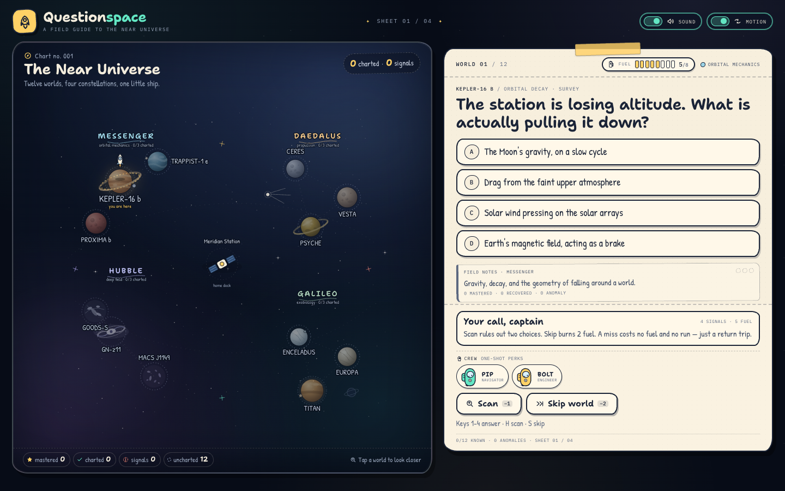
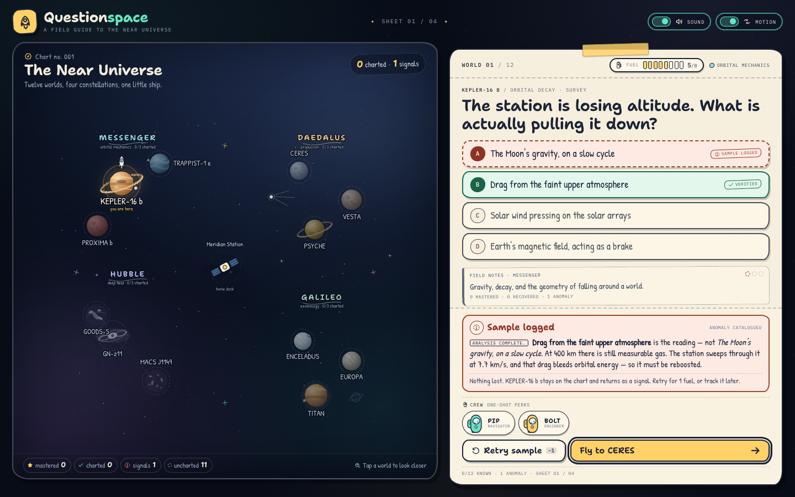
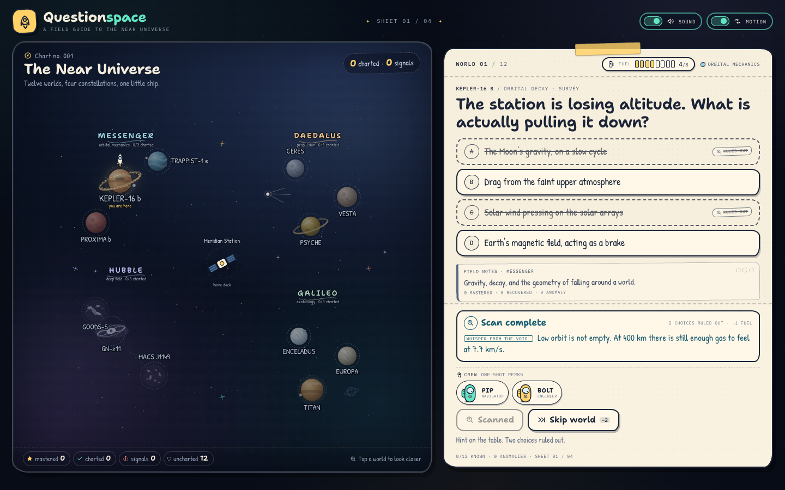
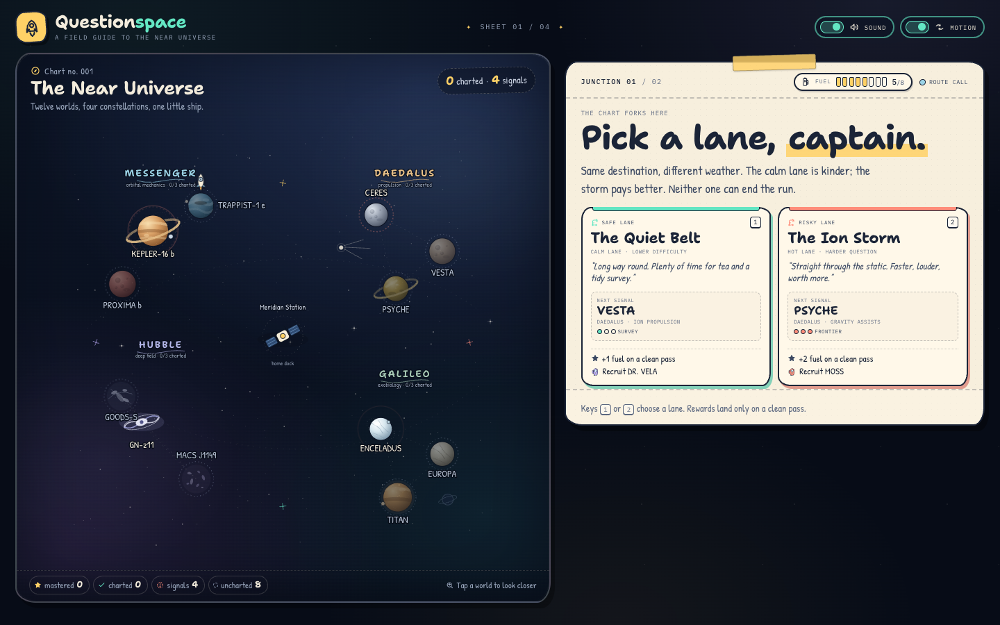

# QuestionSpace

**An illustrated space quiz expedition.** Every question is a planet. Answer it and the
world inks itself into your atlas for good; miss it and the signal keeps singing until you
come back for another look.

[**Play it on GitHub Pages →**](https://abhinav-prabhakar.github.io/QuestionSpace/)



---

## The idea

Most quiz apps turn learning into a progress bar. QuestionSpace turns it into a place.

Twelve worlds sit in four hand-drawn constellations. At the start the atlas is a quiet
sky of rumours: dim planets, faint pencil lines, one small ship docked at Meridian
Station. As you answer, planets brighten, stickers appear, constellation lines ink in, and
the ship hops from world to world. A glance at the map tells you what you actually know —
not how far through a list you are.

A wrong answer is **not** a lost life. It is a sample that came back unusual: the planet
stays on the map as a **signal**, and you can fly back to it later.

| Launch | Question |
| --- | --- |
|  |  |

| Correct | Discovery |
| --- | --- |
|  |  |

---

## What's on the atlas

- **Twelve illustrated worlds**, each drawn by hand in SVG: a ringed gas giant, an ocean
  world, red and grey rock worlds, a metallic asteroid, two ice moons, a hazy orange
  moon, a spiral galaxy, a lensed cluster, and a deep field.
- **Four constellations** — MESSENGER (orbital mechanics), DAEDALUS (propulsion),
  HUBBLE (deep field), GALILEO (exobiology). Each is a trio of worlds joined by a faint
  triangle that inks itself in once you know its members.
- **World states that read without colour**: uncharted worlds are muted with a dashed
  halo; charted worlds get a mint check sticker; mastered worlds get an amber star; a
  missed world keeps a coral signal ring; the current world gets a dashed amber orbit,
  a glow, and the ship hovering above it.
- **A ship that flies** between worlds on a curved trail, plus Meridian Station, a
  wandering comet, and seeded starfields and nebulae.
- **A world card** on tap/click: who lives there, what the region studies, whether the
  signal is due back, and a shortcut to track it.

---

## The loop

The question loop is deliberately instant. Animation happens at the *start* and *end* of
a question, never between reading the choices and answering.

1. **Read and answer.** Four choices, instant feedback. Correct answers stay charted.
2. **Spend fuel on optionality.** Fuel is a hint currency, never health — no answer can
   drain it or end the run.
   - **Scan** (−1): a whisper of a hint plus two ruled-out choices.
   - **Skip world** (−2): leave the world as a signal and fly on.
   - **Retry sample** (−1): after a miss, reopen the same question once.
   - Every third world charted salvages one fuel cell (start 5, cap 8).
3. **Lean on the crew.** Four collectible one-shot perks, each with a personality:
   - **Pip**, navigator — free skip.
   - **Bolt**, engineer — +2 fuel.
   - **Dr.Vela**, science — free scan.
   - **Moss**, medic — free retry after a miss.
   You start with Pip and Bolt. Safe and risky lanes at junctions recruit Vela or Moss;
   a duplicate recruit becomes +1 fuel instead.
4. **Pick a lane.** At two junctions the route forks: the **Quiet Belt** is the
   lowest-difficulty remaining world and pays +1 fuel; the **Ion Storm** is the hardest
   and pays +2. Clean passes only — a miss still leaves a signal.
5. **Follow the signal.** A miss or skip schedules an anomaly (`due` after 3 worlds, then
   further out on each return). When it is due, **T** opens it as a detour; you return to
   the same spot on the route afterwards. At the debrief you can revisit every unresolved
   signal in a new pass, keeping the same crew, fuel, and chart.
6. **Debrief.** A captain's log is generated from the run and can be shared or copied.
   The chart, region breakdown, remaining signals, and crew manifest are all there.

| Scan | Crew perk |
| --- | --- |
|  |  |

| Junction | Signal due |
| --- | --- |
|  |  |

| Captain's log | Detour |
| --- | --- |
|  |  |

---

## Controls

| Action | Key |
| --- | --- |
| Answer A–D | `1`–`4` or `A`–`D` |
| Scan | `H` |
| Skip world | `S` |
| Retry sample | `R` |
| Track a due signal | `T` |
| Fly on | `Enter` / `Space` |
| Choose lane | `1` (quiet) / `2` (storm) |
| Close world card | `Esc` |

Touch: tap a planet for its card, tap a choice to answer, then the wide **Fly to…**
button. On mobile the atlas sits above the question sheet and scrolls with the page.

---

## Accessibility

- **Colour never carries meaning alone.** Feedback pairs a glyph, a word, a border style,
  and a colour. Planet states have distinct silhouettes, stickers, and rings.
- **Full keyboard play**, including the atlas (`Tab` to a world, `Enter` to open it) and
  every action button.
- **Visible focus** on paper (dark ring) and sky (amber ring); the prompt itself is focused
  programmatically but does not show a ring on arrival.
- **Reduced motion** honours `prefers-reduced-motion` and an in-app Motion switch. Under
  either, the ship jump-cuts, trails and blooms are suppressed, and landing advances in
  80 ms.
- **Screen readers** get a live status region for answers, hints, signals, and crew, plus
  the full atlas described per world.
- **Contrast audit** (`npm run check:contrast`) checks every shipped text pair, including
  alpha-composited stamps and eliminated choices. All pairs pass their WCAG target.
- Skip link to the console, 44 px touch targets, and no hover-only information.

---

## Stack

- **React 19 + TypeScript + Vite** — no animation library, no state library. The run is a
  pure reducer; flight and landing are ephemeral UI state.
- **Hand-drawn type**: Shantell Sans (display), Patrick Hand (body), IBM Plex Mono
  (labels), all self-hosted through Fontsource. No font CDN.
- **SVG illustration**: planets, moons, rings, galaxy arms, constellations, station, ship.
  All art is inline and scales cleanly; the starfield is a seeded SVG field.
- **Web Audio** for the ambient hum, radio chatter, and small feedback pings. Audio starts
  from a user gesture and can be switched off at any time.
- **localStorage** persists the expedition (`questionspace.session.v2`), sound, and motion
  preferences. A v1 save is discarded safely.

---

## Run it

```bash
npm install
npm run dev        # http://127.0.0.1:5173
```

```bash
npm run check      # typecheck + 25 tests + contrast audit
npm run build      # production build
npm run preview    # preview the built app
```

The production base path is `/QuestionSpace/` for GitHub Pages; the dev server uses `/`.

---

## Deploy

Pushing to `main` runs `.github/workflows/deploy.yml`:

1. `npm ci`
2. `npm run check`
3. `npm run build`
4. upload `dist/` and deploy with GitHub Pages

Pages is configured with **GitHub Actions** as its source. The live site is
<https://abhinav-prabhakar.github.io/QuestionSpace/>.

---

## Project map

```text
src/
  App.tsx                 phase routing, keyboard map, flight/landing, SR status
  components/
    StarMap.tsx           illustrated atlas: planets, constellations, station, world card
    Console.tsx           question loop, choices, scan/skip/retry, feedback readout
    Briefing.tsx          launch screen, crew intro, rules
    Branch.tsx            quiet/storm lane choice
    Debrief.tsx           stats, captain's log, anomalies, revisit/reset
    CrewDock.tsx          one-shot crew popover
    TopBar.tsx            brand, sound, motion
  data/expedition.ts      worlds, coordinates, questions, crew, routes
  lib/
    session.ts            reducer, selectors, persistence (schema v2)
    log.ts                shareable captain's log
    audio.ts              Web Audio ambience and SFX
    geometry.ts           arcs, wobbly circles, sketched lines
  styles.css              hand-drawn design system, atlas, responsive, reduced motion
scripts/
  check-contrast.mjs      WCAG audit of the shipped palette
  cdp.mjs                 headless Chrome screenshot harness
docs/                     screenshots used above
```

Questions live in `src/data/expedition.ts`; adding a world means a question object plus a
`map` coordinate and a `LOOKS` entry for its planet art.

---

## Screenshots

| Mobile launch | Mobile question |
| --- | --- |
|  |  |

Screenshots are captured at 1440×900 (2× for mobile) with `scripts/cdp.mjs` against a
headless Chrome.
